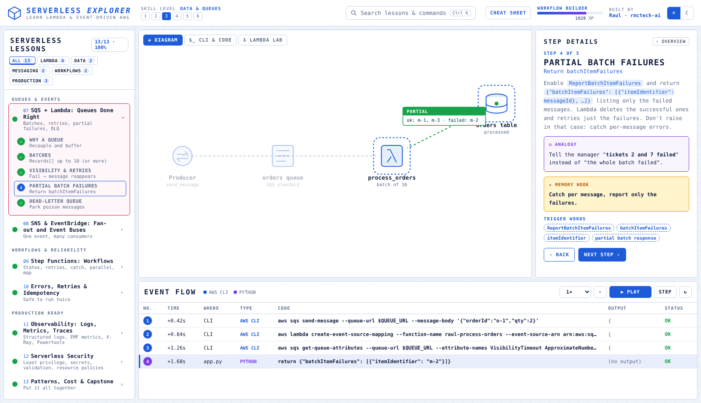

# ⚡ Serverless Explorer — Learn AWS Lambda and event-driven architecture

An interactive, step-by-step course on **serverless on AWS** for Cloud Engineers and AI-automation builders: Lambda in depth (handlers, cold starts, memory, concurrency, versions), API Gateway, DynamoDB, S3 triggers, SQS, SNS & EventBridge, Step Functions, idempotency, observability and serverless security, ending with a production-style capstone. Every lesson animates how events flow through the system, with analogies, memory hooks, trigger words, quizzes, and a **Lambda Lab** where you write real Python handlers that run in your browser against a simulated AWS.

> Created by **Raul** ([@rmctech-ai](https://github.com/rmctech-ai)) · Freelance AI Automation Specialist on the path to Cloud Security.
> Part of the Explorer series: [Linux Explorer](https://github.com/rmctech-ai/linux-explorer) · [Python Explorer](https://github.com/rmctech-ai/python-explorer) · [IAM Explorer](https://github.com/rmctech-ai/iam-explorer) · [VPC Explorer](https://github.com/rmctech-ai/vpc-explorer) · [IaC Explorer](https://github.com/rmctech-ai/iac-explorer) · [CI/CD Explorer](https://github.com/rmctech-ai/cicd-explorer) · [Cloud Security Explorer](https://github.com/rmctech-ai/cloudsecurity-explorer).
> 🏠 Part of **[Raul's Cloud Learning Hub](https://rmctech-ai.github.io/)** · Live course: https://rmctech-ai.github.io/Serverless-Explorer/
> The Explorer course format is inspired by [Protocol Explorer](https://protocol-explorer-alpha.vercel.app/) by Dilum Sanjaya. All lessons, labs and study tools are my own work.



---

## ▶ Run it

No build step. Plain HTML/CSS/JS.

```bash
python3 -m http.server 8000     # then open http://localhost:8000
```

### Publish on GitHub Pages
```bash
git init && git add . && git commit -m "Serverless Explorer"
git branch -M main
git remote add origin https://github.com/rmctech-ai/serverless-explorer.git
git push -u origin main
```
GitHub → **Settings → Pages → Deploy from a branch → `main` / root → Save** → `https://rmctech-ai.github.io/serverless-explorer/`

---

## 🧭 How to use it

| Area | What it does |
|---|---|
| **Lessons** (left) | 13 lessons grouped by track. Click to expand steps. Dots show progress. |
| **Diagram** tab | Animated scene for every step. |
| **$_ CLI & CODE** tab | Types out real commands/code for the step with realistic output. |
| **λ LAMBDA LAB** tab | **Lambda Lab**: real Python (Pyodide, CPython in WebAssembly) with a built-in fake AWS: `boto3` DynamoDB tables (put/get/query/update, conditional writes that raise `ConditionalCheckFailedException`), SQS, SNS, EventBridge, S3, Secrets Manager and Step Functions clients, a Lambda `context`, realistic sample `events` (API Gateway v2, S3, SQS, EventBridge, SNS, schedule) and `invoke()` that prints CloudWatch-style START/END/REPORT lines. `calls()` shows every AWS call your code made. Each challenge calls your handler with tricky events (bad JSON, duplicates, encoded keys) and checks the result. |
| **Step Details** (right) | Explanation, **Analogy**, **Memory Hook**, **Trigger Words**, real-world notes, warnings. |
| **Event Flow** (bottom) | Log of every command so far with type, output and status. |
| **XP & levels** | Earn XP for steps, lessons, quizzes and challenges. Saved in your browser. |
| **Cheat Sheet** | Master hooks + key syntax for every lesson (also [`CHEATSHEET.md`](CHEATSHEET.md)). |

**Keyboard:** `→` / `←` steps · `Space` play · `Ctrl+K` search · `Esc` close.

---

## 📚 Curriculum (13 lessons · 65 steps · 52 quiz questions · 13 hands-on challenges)

| # | Lesson | Track | You'll learn |
|---|---|---|---|
| 01 | What is Serverless? ⚑ | LAMBDA | Run code without managing servers |
| 02 | Handler Anatomy & Cold Starts ⚑ | LAMBDA | event, context, init code, env vars |
| 03 | Memory, Timeout, Concurrency & Versions ⚑ | LAMBDA | The knobs that set speed, cost and safety |
| 04 | API Gateway + Lambda ⚑ | LAMBDA | HTTP requests in, JSON responses out |
| 05 | DynamoDB for Serverless ⚑ | DATA | Keys, get/put/query, conditional writes |
| 06 | S3 Event Triggers ⚑ | DATA | Object created → function runs |
| 07 | SQS + Lambda: Queues Done Right ⚑ | MESSAGING | Batches, retries, partial failures, DLQ |
| 08 | SNS & EventBridge: Fan-out and Event Buses ⚑ | MESSAGING | One event, many consumers |
| 09 | Step Functions: Workflows ⚑ | WORKFLOWS | States, retries, catch, parallel, map |
| 10 | Errors, Retries & Idempotency ⚑ | WORKFLOWS | Safe to run twice |
| 11 | Observability: Logs, Metrics, Traces ⚑ | PRODUCTION | Structured logs, EMF metrics, X-Ray, Powertools |
| 12 | Serverless Security ⚑ | PRODUCTION | Least privilege, secrets, validation, resource policies |
| 13 | Patterns, Cost & Capstone ⚑ | PRODUCTION | Put it all together |

⚑ = has a hands-on challenge.

## 🎯 Study plan & capstone

- **Week 1:** Lessons 1–4 (serverless basics, handler anatomy & cold starts, configuration & releases, API Gateway). Solve every lab challenge.
- **Week 2:** Lessons 5–9 (DynamoDB, S3 triggers, SQS, SNS/EventBridge, Step Functions).
- **Week 3:** Lessons 10–13 (idempotency, observability, security, patterns & capstone).

**Capstone:** In a free-tier AWS account, deploy the lesson 13 order pipeline with SAM: HTTP API → Lambda → DynamoDB (conditional writes) → EventBridge → SQS → email Lambda via SNS, with Powertools logging, an Errors alarm, a DLQ and a $20 budget alert. Add an AI step (Bedrock or the Claude API) that summarizes each order. Document it in a GitHub repo.

## License
MIT © 2026 Raul (rmctech-ai)
